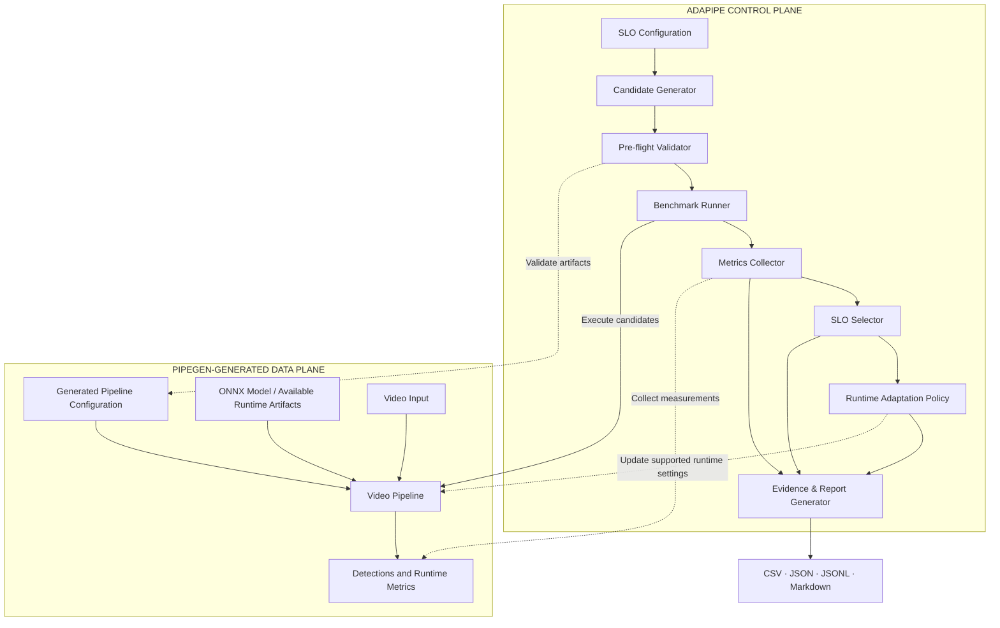

# AdaPipe — Adaptive Pipeline Intelligence for Real-World Constraints

> **Pipelines that meet the deadline — not just run.**

AdaPipe is a constraint-aware, benchmark-driven, runtime-adaptive control layer for PipeGen-generated DeepStream and ONNX vision pipelines. It automates the journey from performance requirements to a measured, selected, and continuously monitored pipeline configuration.

Instead of relying on manual trial and error, AdaPipe evaluates candidate configurations against explicit Service-Level Objectives (SLOs), selects the most suitable feasible configuration, adapts inference behavior under sustained load, and generates reproducible evidence for every decision.

*Built for the CraftifAI Physical AI Hackathon · Track A — PipeGen*

---

## Table of Contents

- [The Problem](#the-problem)
- [Our Solution](#our-solution)
- [What Makes AdaPipe Different](#what-makes-adapipe-different)
- [How It Works](#how-it-works)
- [System Architecture](#system-architecture)
- [Optimization and Decision Logic](#optimization-and-decision-logic)
- [Runtime Adaptation](#runtime-adaptation)
- [Evidence and Observability](#evidence-and-observability)
- [Technology Stack](#technology-stack)
- [Getting Started](#getting-started)
- [Usage Guide](#usage-guide)
- [Configuration](#configuration)
- [Project Structure](#project-structure)
- [Testing and Validation](#testing-and-validation)
- [Hardware Telemetry and Measurement Integrity](#hardware-telemetry-and-measurement-integrity)
- [Limitations and Scope](#limitations-and-scope)
- [Future Roadmap](#future-roadmap)
- [Hackathon Relevance](#hackathon-relevance)

---

## The Problem

### A pipeline that runs is not necessarily a pipeline that works.

Modern edge-AI applications depend on video pipelines that must satisfy operational requirements—not merely execute without errors.

A pipeline can start successfully and still fail in production because it:
- **Misses throughput targets:** Processing fewer frames per second than the application requires.
- **Exceeds latency limits:** Taking too long to process frames, even when average performance appears acceptable.
- **Compromises detection quality:** Improving speed at the expense of confidence or useful visual detail.
- **Wastes compute resources:** Running unnecessarily expensive inference when the scene or workload is relatively simple.
- **Fails under changing workloads:** Becoming overloaded when scene complexity, object density, or incoming frame rates increase.
- **Lacks reproducible evidence:** Providing no systematic way to explain why a configuration was selected or how it behaved under stress.

### Why existing manual tuning is insufficient

Developers often tune parameters such as inference interval, input resolution, and batch size through repeated experiments.

This creates several challenges:

| Challenge | Operational Consequence |
| :--- | :--- |
| **Manual configuration search** | Slow iteration and inconsistent results |
| **No common benchmark conditions** | Difficult or unfair comparisons |
| **Single-metric optimization** | Fast configurations may violate latency or quality requirements |
| **Static runtime settings** | Performance can deteriorate when workload changes |
| **No quality guardrail** | Aggressive throttling may degrade useful detections |
| **Incomplete telemetry** | Performance claims become difficult to verify |
| **Missing decision history** | Difficult to reproduce, debug, or audit configuration changes |

The fundamental problem is the absence of an automated feedback loop connecting requirements, benchmarking, configuration selection, runtime adaptation, and evidence.

---

## Our Solution

### AdaPipe: Measure → Benchmark → Select → Adapt → Audit

AdaPipe adds a control plane around the vision pipeline generated through PipeGen.

The control plane evaluates what the application needs, measures what candidate configurations deliver, and makes configuration decisions using explicit rules.

It has five core responsibilities:

1. **Specify requirements:** Load minimum FPS, maximum p95 latency, and minimum detection confidence from a configuration file.
2. **Validate before execution:** Check requirements, video inputs, candidate configurations, and expected pipeline artifacts before expensive benchmark runs.
3. **Benchmark systematically:** Execute baseline, balanced, and fast configurations on the same input under controlled, sequential conditions.
4. **Select and adapt:** Choose a configuration using SLO compliance and a deterministic fallback policy, then adjust inference behavior when sustained load threatens latency.
5. **Generate evidence:** Export measurements, selection rationale, and timestamped adaptation events for inspection and reproduction.

The goal is not to maximize FPS in isolation. It is to find and maintain a configuration that best satisfies the application's actual requirements.

---

## What Makes AdaPipe Different?

AdaPipe is designed around operational reliability rather than a one-time performance benchmark.

| Capability | Why It Matters |
| :--- | :--- |
| **SLO-driven evaluation** | Defines success before benchmarking begins |
| **Bounded candidate search** | Makes configuration exploration practical and repeatable |
| **Pre-flight validation** | Detects invalid inputs before expensive execution |
| **Comparable benchmarks** | Evaluates candidates using identical video inputs |
| **Deterministic selection** | Makes configuration choices explainable |
| **Sustained-load adaptation** | Responds to persistent latency violations rather than isolated spikes |
| **Quality-preservation guardrail** | Prevents an adaptation from silently degrading detection confidence beyond the configured threshold |
| **Recovery with hysteresis** | Reduces unnecessary switching when workload fluctuates |
| **Audit-ready artifacts** | Records metrics, decisions, and runtime changes |

The central engineering idea: pipeline optimization should be a measurable decision process, not a collection of undocumented manual tweaks.

AdaPipe's proposed contribution is the integration of these mechanisms into one control loop for PipeGen-generated vision pipelines. Its performance and novelty should be evaluated against appropriate baselines rather than assumed.

---

## How It Works

### 1. Define the Service-Level Objectives
The user defines operational requirements in `configs/slo.yaml`. Example requirements include minimum acceptable throughput, maximum acceptable p95 latency, and minimum detection confidence. These requirements define the conditions a candidate must satisfy to be considered feasible.

### 2. Generate Candidate Configurations
AdaPipe derives three bounded configurations from `configs/candidates.yaml`:
- **Baseline:** A reference configuration for comparison (every frame, native resolution).
- **Balanced:** A compromise between throughput, latency, and detection quality (every 2nd frame, 960x540).
- **Fast:** A configuration that prioritizes throughput and responsiveness (every 3rd frame, 640x360).

The bounded search keeps the evaluation manageable and makes the comparison reproducible.

### 3. Validate Before Spending Compute
Before benchmarking, AdaPipe checks for configuration errors, invalid requirements, unreadable video inputs, and missing expected pipeline artifacts. Invalid candidates produce clear, machine-readable reasons rather than misleading benchmark results.

### 4. Benchmark on Identical Inputs
Each valid candidate is executed sequentially on the same video stream. The benchmark runner separates warmup frames from measured frames so that initialization overhead does not distort steady-state performance measurements.

### 5. Select the Most Suitable Configuration
AdaPipe first identifies candidates that satisfy the defined SLOs. When feasible candidates exist, the selector chooses the candidate with the highest measured detection confidence. When no candidate satisfies all requirements, AdaPipe uses a normalized violation score to select a least-violating candidate, explicitly marking the outcome as non-compliant.

### 6. Adapt During Runtime
Once a configuration has been selected, AdaPipe monitors rolling performance windows. If latency violations persist across 3 consecutive windows, the runtime policy increases the inference interval (throttling frames). If workload conditions improve consistently over 5 windows, the policy restores a less aggressive interval. A quality guardrail monitors detection confidence and triggers a rollback when the observed drop exceeds 20%.

### 7. Produce Verifiable Evidence
The final stage generates structured benchmark results (`benchmark_results.csv`), a machine-readable selection report (`selection_report.json`), a human-readable summary (`selection_report.md`), and an event-by-event adaptation log (`adaptation_log.jsonl`).

---

## System Architecture

AdaPipe separates control-plane intelligence from data-plane execution.



### Control Plane
The control plane owns the optimization process:
- `config_loader.py` — loads requirements and candidate settings.
- `candidate_generator.py` — derives bounded candidate configurations.
- `validator.py` — validates inputs and prerequisites.
- `benchmark_runner.py` — executes candidate benchmarks.
- `metrics_collector.py` — collects performance and resource measurements.
- `selector.py` — evaluates SLO compliance and chooses a configuration.
- `runtime_policy.py` — applies adaptation and recovery rules.
- `report.py` — exports evaluation and audit artifacts.

### Data Plane
The data plane is the actual video-processing pipeline produced by PipeGen under `pipegen_output/generated_pipeline/`:
- `config.yaml`
- `model.onnx`
- `pipeline.py`

The generated pipeline is responsible for processing video through decode, preprocessing, inference, and postprocessing. AdaPipe orchestrates and evaluates this pipeline; it does not replace PipeGen's generation responsibilities.

For additional sequence and state-transition diagrams, see [docs/architecture.md](docs/architecture.md).

---

## Optimization and Decision Logic

### SLO-Based Candidate Evaluation
For each candidate $c$, AdaPipe evaluates the measured metrics against configured requirements. A candidate is feasible when all three conditions hold:

$$\text{FPS}_c \geq \text{FPS}_{\min}$$

$$p95_c \leq L_{\max}$$

$$\text{Confidence}_c \geq C_{\min}$$

Where:
- $\text{FPS}_c$ is the measured throughput.
- $p95_c$ is the measured 95th-percentile latency.
- $L_{\max}$ is the configured latency limit.
- $C_{\min}$ is the minimum acceptable detection confidence.

The selection policy prioritizes feasible candidates, choosing the one with the highest measured confidence.

### When No Candidate Satisfies Every Requirement
Rather than incorrectly labeling a failing candidate as successful, AdaPipe calculates a normalized violation score:

$$V_c = w_f \frac{\max(0, \text{FPS}_{\min} - \text{FPS}_c)}{\text{FPS}_{\min}} + w_l \frac{\max(0, p95_c - L_{\max})}{L_{\max}} + w_q \frac{\max(0, C_{\min} - \text{Confidence}_c)}{C_{\min}}$$

A lower score represents a smaller normalized aggregate violation. The fallback is explicit: a least-violating configuration is marked as `SLO_UNMET` to maintain honest reporting.

---

## Runtime Adaptation

Static benchmarking identifies a good starting configuration; runtime adaptation addresses post-deployment dynamics.

### Under Sustained Load
1. Measure throughput, latency, confidence, and available resource telemetry in rolling windows.
2. Detect persistent latency violations across 3 consecutive windows ($p95 > L_{\max}$).
3. Increase the inference interval within supported bounds ($1 \rightarrow 2 \rightarrow 3$).
4. Revert adaptation if the quality guardrail is violated.

### During Recovery
When workload conditions improve consistently ($p95 < 0.7 \times L_{\max}$ for 5 consecutive windows), the policy decreases the inference interval, restoring more frequent inference without exceeding the original selected configuration.

### Quality Preservation Guardrail
The policy reverts an adaptation when detection confidence drops by more than $20\%$ relative to reference baseline, ensuring latency reduction does not cause perceptual collapse.

---

## Evidence and Observability

All generated artifacts are written directly to `results/`:

| Artifact | Purpose |
| :--- | :--- |
| `benchmark_results.csv` | Per-candidate measurements and resource telemetry |
| `selection_report.json` | Machine-readable SLO status, candidate results, selected configuration, and rationale |
| `selection_report.md` | Human-readable evaluation summary |
| `adaptation_log.jsonl` | Timestamped adaptation, recovery, and guardrail events |
| `logs/` | Individual candidate execution logs |

### Benchmark Measurements
The benchmark CSV records:
- Candidate configuration ID.
- Frames processed and elapsed wall-clock time.
- Measured FPS.
- $p50$ and $p95$ latency in milliseconds.
- Mean detection confidence and detection count.
- GPU utilization % and GPU memory MB (via `nvidia-smi`).
- CPU utilization % and system memory MB (via `psutil`).

---

## Technology Stack

| Component | Technology |
| :--- | :--- |
| **Language** | Python 3.10+ |
| **Pipeline Generation** | PipeGen (v0.5.1) |
| **Video Analytics** | NVIDIA DeepStream 7.1 / GStreamer |
| **Model Representation** | ONNX |
| **Accelerated Inference** | TensorRT / DirectML / ONNX Runtime |
| **Video & Timing Utilities** | OpenCV and high-resolution system timers |
| **GPU Telemetry** | NVIDIA `nvidia-smi` |
| **Configuration** | YAML (`pyyaml`) |
| **Evidence Formats** | CSV, JSON, JSONL, Markdown |
| **Interactive Dashboard** | Streamlit |
| **Automated Testing** | pytest |
| **Video Utilities** | FFmpeg |

---

## Getting Started

### Prerequisites
- Python 3.10 or newer.
- Compatible NVIDIA GPU and driver (tested on NVIDIA GeForce RTX 3050 Laptop GPU, Driver 581.86, CUDA 13.0).
- Docker and NVIDIA Container Toolkit configured.
- PipeGen installed (`PipeGen_0.5.1_amd64.deb`).
- FFmpeg available in system PATH.
- Readable test video files (`demo/sample_video.mp4`, `demo/high_load_video.mp4`).

### 1. Clone the repository
```bash
git clone https://github.com/PaveshKamalan/AdaPipe.git
cd AdaPipe
```

### 2. Create a virtual environment
On Linux / WSL Ubuntu:
```bash
python3 -m venv .venv
source .venv/bin/activate
```
On Windows PowerShell:
```powershell
python -m venv .venv
.\.venv\Scripts\Activate.ps1
```

### 3. Install Python dependencies
```bash
python -m pip install --upgrade pip
pip install -r requirements.txt
```

### 4. Verify external prerequisites
```bash
ffmpeg -version
nvidia-smi
pipegen --version
```

Confirm that the required PipeGen-generated artifacts exist under `pipegen_output/generated_pipeline/` (`config.yaml`, `model.onnx`, `pipeline.py`).

---

## Usage Guide

### Run the complete workflow
```bash
python -m adapipe.main --mode all
```
Executes end-to-end orchestration: validation, candidate benchmarking, selection, adaptive execution, and report generation.

### Benchmark candidate configurations
```bash
python -m adapipe.main --mode benchmark --duration 45 --warmup 5
```

### Select the best candidate
```bash
python -m adapipe.main --mode select
```

### Run adaptive execution
```bash
python -m adapipe.main --mode adaptive
```

### Generate reports
```bash
python -m adapipe.main --mode report
```

### Launch the interactive dashboard
```bash
streamlit run adapipe/dashboard.py
```

### Run automated tests
```bash
python -m pytest tests/ -v
```

### Convenience scripts
- **Linux / WSL:** `./scripts/run_benchmark.sh` or `./scripts/run_adapipe.sh`
- **Windows PowerShell:** `.\scripts\run_benchmark.ps1` or `.\scripts\run_adapipe.ps1`

---

## Configuration

### SLO Configuration (`configs/slo.yaml`)
```yaml
slo:
  min_fps: 15
  max_p95_latency_ms: 250
  min_detection_confidence: 0.45
benchmark:
  duration_seconds: 45
  warmup_seconds: 5
runtime_policy:
  degrade_after_violations: 3
  recover_after_success_windows: 5
  recovery_latency_ratio: 0.7
  quality_drop_revert_threshold: 0.20
```

### Candidate Configuration (`configs/candidates.yaml`)
Defines the bounded search space for `baseline`, `balanced`, and `fast` candidates across inference intervals and resolutions.

---

## Project Structure

```
AdaPipe/
├── adapipe/
│   ├── __init__.py
│   ├── config_loader.py
│   ├── candidate_generator.py
│   ├── validator.py
│   ├── benchmark_runner.py
│   ├── metrics_collector.py
│   ├── selector.py
│   ├── runtime_policy.py
│   ├── report.py
│   ├── ble_event_source.py
│   ├── main.py
│   └── dashboard.py
├── configs/
│   ├── slo.yaml
│   ├── candidates.yaml
│   └── usecase_door_count.yaml
├── pipegen_output/
│   └── generated_pipeline/
│       ├── config.yaml
│       ├── model.onnx
│       └── pipeline.py
├── scripts/
│   ├── run_benchmark.sh
│   ├── run_benchmark.ps1
│   ├── run_adapipe.sh
│   ├── run_adapipe.ps1
│   ├── export_onnx_model.py
│   └── generate_demo_videos.py
├── demo/
│   ├── sample_video.mp4
│   ├── high_load_video.mp4
│   └── expected_events.json
├── tests/
├── docs/
│   └── architecture.md
├── prd/
│   ├── track_a_prd.md
│   └── esp32_ble_broadcast_prd.md
├── results/
│   ├── benchmark_results.csv
│   ├── selection_report.json
│   ├── selection_report.md
│   ├── adaptation_log.jsonl
│   └── logs/
├── requirements.txt
└── README.md
```

---

## Testing and Validation

AdaPipe includes 26 unit and integration tests covering the core control-loop behavior:

| ID | Scenario | Expected Criterion | Status |
| :--- | :--- | :--- | :---: |
| **AC-01** | Load valid SLO configuration | Configuration loads without errors | **PASS** |
| **AC-02** | Reject invalid SLO or missing video | Clear validation error before execution | **PASS** |
| **AC-03** | Benchmark valid candidates | Sequential execution on identical input | **PASS** |
| **AC-04** | Export benchmark CSV | One result row per candidate | **PASS** |
| **AC-05** | Select configuration | Highest-confidence feasible candidate or least-violating fallback | **PASS** |
| **AC-06** | Export selection report | Includes status, metrics, and rationale | **PASS** |
| **AC-07** | Adapt under sustained high load | Degradation after three consecutive latency violations | **PASS** |
| **AC-08** | Recover under low load | Upgrade after five consecutive low-load windows | **PASS** |
| **AC-09** | Enforce quality guardrail | Revert when configured confidence-drop threshold is exceeded | **PASS** |
| **AC-10** | Record adaptation history | Timestamped JSONL events in `adaptation_log.jsonl` | **PASS** |
| **AC-11** | Automated test suite | All 26 tests pass in 7.62s | **PASS** |

---

## Hardware Telemetry and Measurement Integrity

- **No fabricated metrics:** FPS, latency percentiles, detection statistics, and hardware measurements come directly from system timers, OpenCV, and `nvidia-smi`.
- **Missing telemetry remains missing:** If `nvidia-smi` is unavailable, `null` is recorded, never an artificial zero.
- **Honest peripheral simulation:** The ESP32 BLE advertisement module (`adapipe/ble_event_source.py`) is explicitly simulated in software without claiming physical BLE hardware.
- **Reproducibility over presentation:** Raw execution logs are preserved in `results/logs/` for complete auditability.

---

## Limitations and Scope

- **Bounded candidate search:** Focuses on three curated configurations for reproducible evaluation.
- **Single-model evaluation:** Benchmarks one ONNX detector model across resolution and interval combinations.
- **Limited adaptation controls:** Focuses on inference-interval throttling and ROI cropping.
- **Telemetry dependencies:** GPU resource measurements depend on NVIDIA tooling and driver support.
- **Confidence is not complete accuracy:** Confidence serves as a runtime proxy, not a complete safety certification.
- **No automatic INT8 claim:** INT8 precision is reserved for calibrated TensorRT targets.

---

## Future Roadmap

- **Expanded configuration search:** Automated Pareto optimization over batch sizes, precision, and multi-model cascades.
- **Workload-aware policies:** Utilizing dynamic scene complexity and density estimators.
- **Multi-camera stream orchestration:** Extending runtime control across distributed camera streams.
- **Physical ESP32 firmware integration:** Binding hardware BLE beacons directly via PipeGen-generated FirmGen nodes.

---

## Hackathon Relevance

AdaPipe was developed for the **CraftifAI Physical AI Hackathon — Track A: PipeGen**. It bridges the operational gap between generating a vision pipeline and verifying production compliance:

$$\text{PipeGen Pipeline} \longrightarrow \text{Validation} \longrightarrow \text{Benchmarking} \longrightarrow \text{SLO Selection} \longrightarrow \text{Runtime Adaptation} \longrightarrow \text{Auditable Evidence}$$

---

## Final Principle

> A successful pipeline is not merely one that runs. It is one whose performance is measured against its requirements, whose trade-offs are understood, and whose behavior can be verified.

**AdaPipe — Pipelines that meet the deadline, not just run.**
