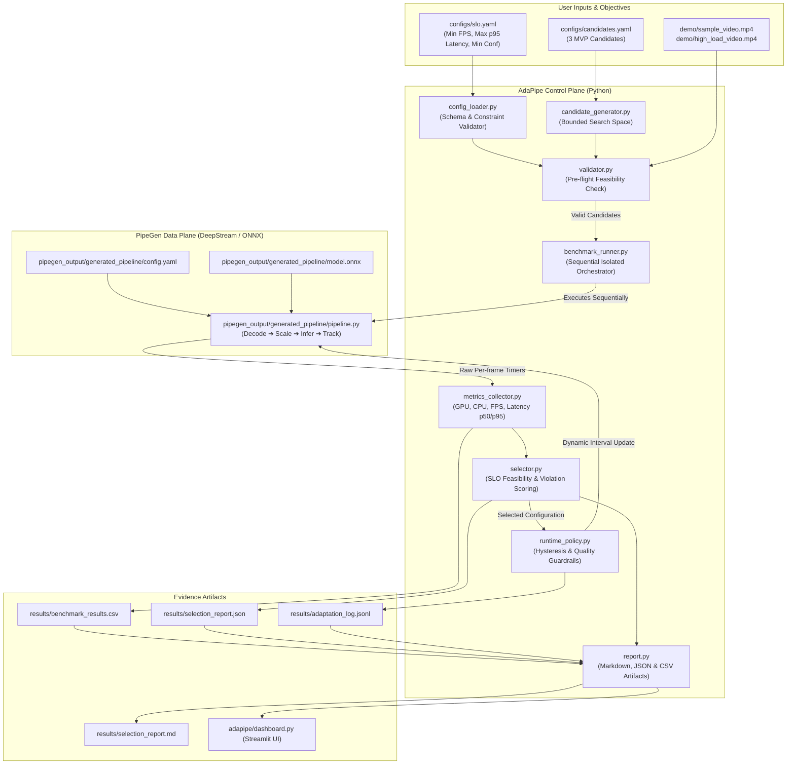
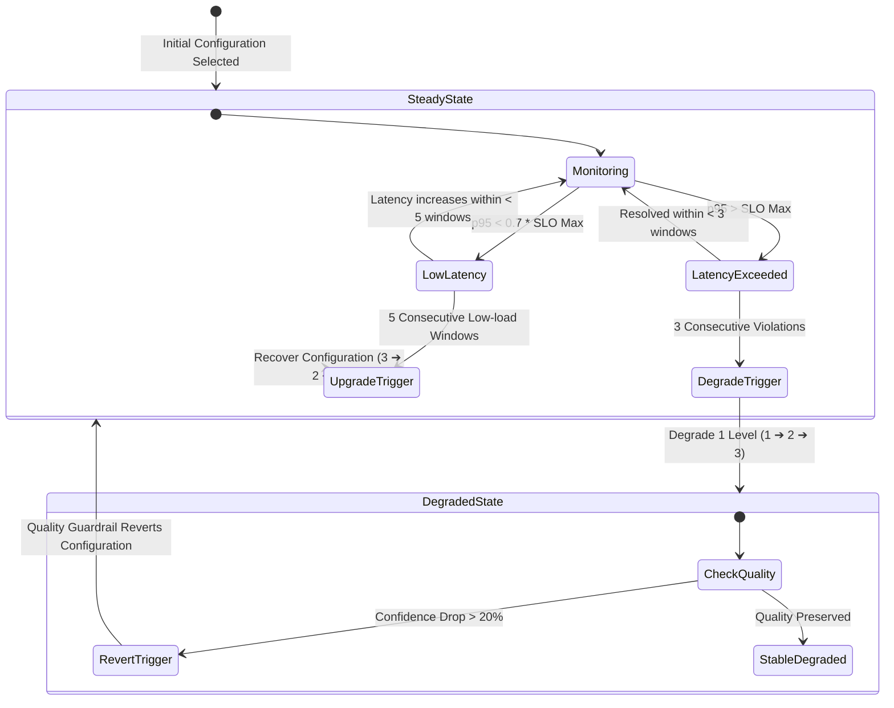

# AdaPipe Architecture Specification

## Overview

AdaPipe implements a **two-plane control loop** designed to wrap and augment PipeGen-generated video analytics pipelines:

1. **Control Plane:** Responsible for SLO parsing, candidate configuration generation, pre-flight validation, benchmark orchestration, configuration selection, hysteresis-driven adaptation, and evidence generation.
2. **Data Plane:** The PipeGen-generated DeepStream / ONNX Runtime vision pipeline performing video decode, frame scaling, inference execution, object tracking, and bounding-box post-processing.

---

## Architectural Diagram

---

## Control Plane vs. Data Plane Separation

| Plane | Component | Language / Framework | Responsibilities |
| :--- | :--- | :--- | :--- |
| **Control Plane** | `config_loader` | Python 3.10+ / PyYAML | Loads SLO constraints (`min_fps`, `max_p95_latency_ms`, `min_detection_confidence`). |
| **Control Plane** | `candidate_generator` | Python 3.10+ | Instantiates the bounded candidate matrix (baseline, balanced, fast). |
| **Control Plane** | `validator` | Python 3.10+ / OpenCV | Verifies video readability, numeric validity, and PipeGen artifact presence. |
| **Control Plane** | `benchmark_runner` | Python 3.10+ | Runs each candidate sequentially, isolates runs, ignores warmup period. |
| **Control Plane** | `metrics_collector` | Python 3.10+ / psutil / nvidia-smi | Captures p50/p95 latency, FPS, GPU util %, GPU memory MB, CPU %. |
| **Control Plane** | `selector` | Python 3.10+ | Evaluates SLO feasibility and calculates normalized violation score $V_c$. |
| **Control Plane** | `runtime_policy` | Python 3.10+ | Evaluates 5-window rolling telemetry; applies degradation and recovery hysteresis. |
| **Control Plane** | `report` | Python 3.10+ / pandas | Generates reproducible CSV, JSON, JSONL, and Markdown evidence. |
| **Data Plane** | `pipeline.py` | OpenCV / ONNX Runtime / CUDA / DirectML | Decodes input stream, scales resolution, executes ONNX neural network, filters NMS. |

---

## Hysteresis & Guardrail State Machine

